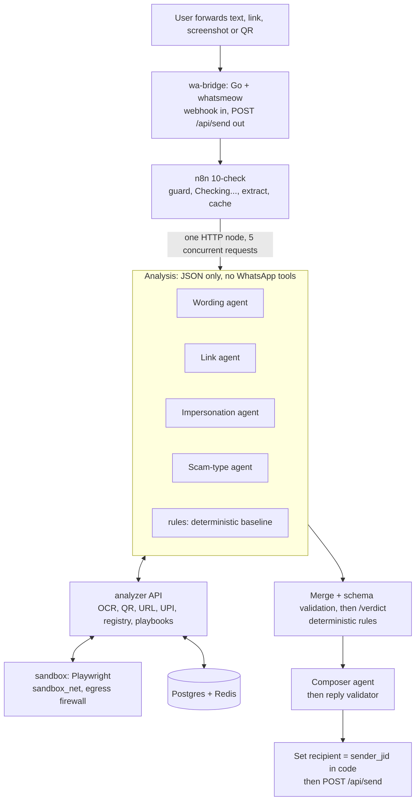

# ScamSaathi

ScamSaathi is a WhatsApp bot that checks forwarded messages, links, QR codes and screenshots for UPI scams and bank or insurer impersonation in India. It replies with a verdict (`SCAM`, `SUSPICIOUS` or `No red flags found`), the evidence behind it, and what to do next, in English or Hindi.

The requirements are in [docs/SRS.md](docs/SRS.md). Build progress and gate reports are in [docs/progress/](docs/progress/), and the evaluation results are in [docs/eval.md](docs/eval.md).

> **Warning: whatsmeow is unofficial.** The bridge drives WhatsApp Web's multi-device protocol, not Meta's Business API. This breaks WhatsApp's terms of service, and **the number can be banned**. Use a spare number you can afford to lose, and use it for demos and coursework only. See [Moving to the official Cloud API](#moving-to-the-official-whatsapp-cloud-api).

## Architecture



| Service | What it does |
|---|---|
| `wa-bridge` | Go channel adapter on `go.mau.fi/whatsmeow`, with the version pinned in `bridge/go.sum`. It handles the WhatsApp session, posts SRS 6.2 webhooks to n8n, and exposes `POST /api/send`, `/api/health` and `/qr`. |
| `n8n` | Orchestration. Workflows: `00-echo`, `10-check`, `11-agents` (the four AI Agent nodes), `20-health`, `30-registry-crawl`, `40-campaigns`. |
| `analyzer` | FastAPI service for the deterministic checks: extraction (Tesseract `eng+hin`, pyzbar/OpenCV), URL static checks, reputation feeds, UPI parsing, registry and playbooks, verdict engine, reply validation, cache, campaigns and the admin view. |
| `sandbox` | Playwright Chromium on its own network. It is the only component that fetches user URLs. |
| `llm-gateway` | OpenAI-compatible proxy. It holds the LLM credentials, so n8n never sees them. The provider is set by env (`LLM_PROVIDER`, `LLM_MODEL`). |
| `postgres`, `redis` | Registry, checks, cache and campaigns; rate limits, dedupe and language preference. |

### How a check works
1. **Intake.** The bridge posts the webhook. n8n then:
   - sets `trace_id` and `sender_jid`;
   - drops group and status messages;
   - runs `/intake/guard` for dedupe, the 20/hour rate limit, commands and off-topic replies;
   - sends "Checking…".
2. **Extraction.** `/extract` pulls out URLs, UPI URIs and IDs, phone numbers, SMS sender IDs, amounts, claimed brands, OCR text and QR payloads. Then the cache lookup runs: a hit under 24 h skips straight to the composer.
3. **Analysis.** Four AI agents run in parallel, each with its own allowlisted analyzer tools and a Structured Output Parser. Alongside them, the deterministic `rules` baseline applies the same tools without any LLM.
4. **Validation.** A Code node merges the results, validates them against SRS 6.4 and drops unknown signal codes. `/verdict` then decides. Hard signals win, and weights come from [analyzer/weights.yaml](analyzer/weights.yaml).
5. **Reply.** The composer agent words the verdict. `/reply/finalize` checks the result: no "safe", at most 900 characters, no links or numbers that aren't in the input, and non-official links are defanged. If any check fails, a deterministic template is used instead.
6. **Send and record.** A **Set node** sets `recipient = sender_jid`, and the reply goes out through `POST /api/send`. The check is then written to Postgres, and a campaign alert is raised if needed.

## Setup

Requirements: Docker with Compose v2, about 8 GB of RAM, and about 15 GB of free disk. Your LLM credentials: a Vertex AI service account, or a key for any OpenAI-compatible provider.

```sh
make env        # creates .env with random secrets (never committed)
# edit .env: LLM_* / GCP_PROJECT / GOOGLE_CREDENTIALS_FILE, ADMIN_JID, optional SENDER_ALLOWLIST and feed keys
make up         # builds and starts everything, waits until all containers are healthy
make test       # unit tests (≥90 % coverage, 100 % branch on verdict.py)
make eval       # 60 fixtures end to end through the webhook (bridge mocked) → reports/eval.md
make security   # injection, SSRF and recipient-tampering suites
make demo       # demos D1–D5 + D8 campaign through the webhook test path
```

Without `make` (for example on Windows), run `sh scripts/tasks.sh <target>`. The Makefile is a thin wrapper around it.

### Linking WhatsApp (QR login)
1. Put the spare SIM in a phone and install WhatsApp on it.
2. Run `make qr`, or open <http://127.0.0.1:8080/qr>.
3. On the bot phone, go to WhatsApp → **Linked devices** → **Link a device**, and scan the code.
4. Check that `curl http://127.0.0.1:8080/api/health` shows `"logged_in": true`.
5. From another phone, send `help` to the bot number.

Sessions can expire after about 20 days. `20-health` polls every 60 s and alerts the admin (and `ALERT_WEBHOOK_URL`, if set) when the bridge is unlinked. To re-link, run `make qr` again.

**Echo test (Phase 1):** set `BRIDGE_WEBHOOK_PATH=wa-echo` in `.env` and run `docker compose up -d wa-bridge`. Messages are then echoed back. Set it back to `wa-inbound` afterwards.

### Useful URLs (localhost only)
- n8n editor: <http://127.0.0.1:5678>. Log in with `N8N_OWNER_EMAIL` / `N8N_OWNER_PASSWORD` from `.env`.
- Admin view: `http://127.0.0.1:8000/admin?token=<ADMIN_TOKEN>`. It shows the last 100 checks, campaigns, registry entries awaiting review and bridge health.

## Security design

- **Analysis agents have no WhatsApp, filesystem or shell tools.** Their tools are allowlisted in [n8n/build_workflows.py](n8n/build_workflows.py) (`TOOL_ALLOWLIST`), and [tests/unit/test_workflows.py](tests/unit/test_workflows.py) enforces this.
- **The recipient is set by code.** Every send uses `sender_jid` from the webhook, or `ADMIN_JID`, through a Set node. The bridge adds a second check: `/api/send` needs a token and only replies to direct chats that messaged the bot in the last 24 h. `SENDER_ALLOWLIST` can limit the bot to known numbers.
- **Untrusted content is data.** User, OCR and QR text is wrapped in `<untrusted>`, and any attempt to close the tag is removed. Every agent gets the same anti-injection preamble. Outputs are schema-validated, unknown codes are dropped, and the agent's own severity is ignored.
- **The verdict is deterministic.** `analyzer/app/verdict.py` decides. Trust signals that lower the score are accepted only from the deterministic `rules` source.
- **SSRF protection.**
  - Only the sandbox fetches user URLs: an iptables egress firewall blocks RFC1918, link-local/metadata and CGNAT ranges, and each hop is resolved and must be a public IP.
  - Docker service names are refused, with a 20 s timeout and a 5 MB cap.
  - The container runs on a read-only rootfs as a non-root user, and downloads are hashed and never opened.
- **Secrets** live only in `.env`, which is gitignored. A pre-commit hook and CI run [scripts/check-secrets.sh](scripts/check-secrets.sh).
- **Privacy.** Sender numbers are stored as salted SHA-256 hashes, and raw text is deleted after 7 days.

## Registry

The registry has 15 banks and 10 insurers in [registry/seed/](registry/seed/), plus 15 playbooks. Every entry was drafted from the cited web sources and has **`status: needs_review`**: a person must check each field against the official website and approve it in the admin view. Empty fields mean no verifiable source was found; nothing was invented. CI rejects any policy without `quote` and `source_url` ([scripts/validate_seeds.py](scripts/validate_seeds.py)).

## Limits

- whatsmeow is unofficial and the number can be banned (see above).
- Registry facts are drafts until a human reviews them. Some quotes come from press coverage of the institution's own advisory, and some helplines are missing, including LIC.
- Threat feeds need keys: Safe Browsing is for non-commercial use (use Web Risk for commercial), and VirusTotal and URLhaus each need a key. Without keys those feeds report `unknown`. OpenPhish, RDAP and crt.sh need no key.
- OCR is Tesseract only: Hindi text inside images is read with `eng+hin`, but heavily styled screenshots may lose text. There is no vision-LLM fallback in v1.
- The sandbox uses a fresh browser per detonation inside one long-lived container, not one container per detonation (see [docs/decisions.md](docs/decisions.md)).
- The admin MCP agent (optional in the SRS) is not shipped. The admin view is a read-only HTML page.
- Voice notes, video and documents are not analysed (out of scope for v1).

## Moving to the official WhatsApp Cloud API

The channel is an adapter. Only two parts change:
1. **`bridge/`.** Replace it with a small Cloud API webhook receiver. It must:
   - verify Meta's signature;
   - download media through the Graph API into the shared `media` volume;
   - post the same SRS 6.2 payload (`msg_id`, `sender_jid`, `type`, `text`, `caption`, `media_path`, `forwarded`, `timestamp`) to `n8n /webhook/wa-inbound`.
2. **The n8n send nodes.** Point the HTTP send nodes in `n8n/build_workflows.py` (the `"/api/send"` calls) at `https://graph.facebook.com/v{N}/{phone-number-id}/messages` with a Bearer token, mapping `recipient` → `to` and `message` → `text.body`. The recipient is still taken only from the webhook's sender.

Everything else stays the same: the analyzer, agents, verdict engine, registry and tests. Outside the 24-hour customer-service window, replies need approved message templates.

## Repository layout

```
bridge/            whatsmeow adapter (Go) + Dockerfile
analyzer/app/      FastAPI: extract, url_static, reputation/, upi, registry, playbooks, signals, verdict, rules, reply, store, intake, admin
analyzer/weights.yaml
sandbox/           Playwright detonation service + egress firewall entrypoint
llm-gateway/       OpenAI-compatible LLM proxy (provider from env)
n8n/               build_workflows.py (source) → workflows/*.json (exports); bootstrap/
registry/seed/     banks/, insurers/, playbooks/
db/migrations/     SRS 6.1 schema
tests/             unit/, security/, e2e/, fixtures/ (60 items + images), mock_bridge/
docs/              SRS, decisions, traceability, eval, progress/
```
